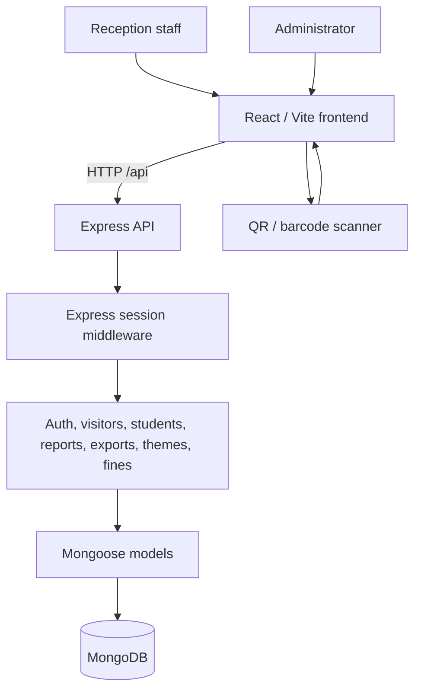

# IHS Visitor Management Architecture

## System context

The application has a React/Vite frontend and an Express API. The API uses Mongoose to persist visitor, student, fine, and related records in MongoDB.

## Main workflows

- Visitor check-in and check-out
- Visitor category, purpose, and person-to-meet recording
- Printable visitor badges
- Student QR/barcode entry scanning
- Student registration and bulk import
- Dashboard metrics, reports, and CSV export
- Fine records and card theme configuration

## Repository layout

- `backend/index.js`: Express application entry point
- `backend/routes/`: API route modules
- `backend/models/`: Mongoose schemas
- `backend/middleware/`: authentication middleware
- `backend/scripts/`: maintenance and seed scripts
- `client/src/`: React screens, components, contexts, and styles
- `FEATURES.md`: user-facing feature guide

## Deployment and security notes

- Configure a unique, high-entropy `SESSION_SECRET`; do not use the development fallback.
- Restrict `ALLOWED_ORIGINS` to known frontend origins rather than allowing arbitrary hosts.
- Confirm secure cookies and trusted proxy settings for the production hosting topology.
- Store MongoDB credentials in the hosting provider's secret manager.
- Validate uploaded import files and protect export endpoints with appropriate authorization.
- Keep generated `client/dist/` output out of source control.
